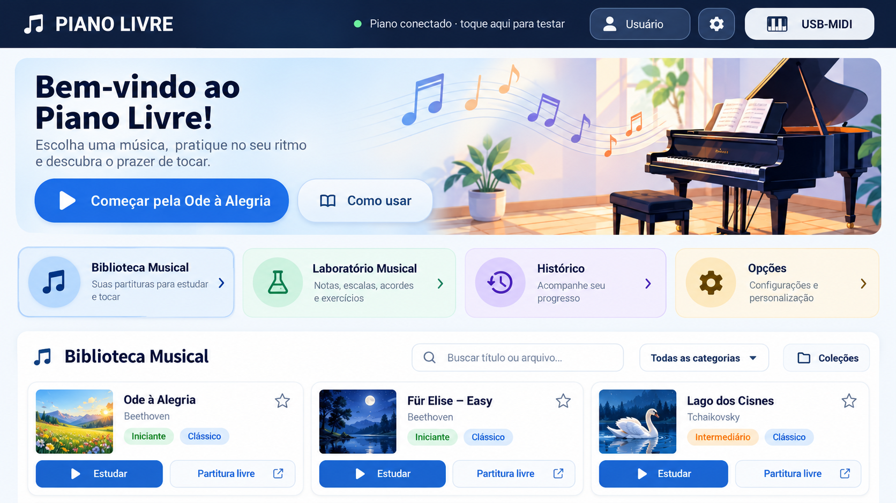

# PIANO LIVRE — PROMPT 1 DE 4
## Implementação da nova tela inicial — referência visual obrigatória

**Repositório exclusivo:** https://github.com/atshimura/Piano-livre-aberto  
**Escopo:** tela inicial, biblioteca visível na tela inicial, atalhos e cabeçalho desta tela.  
**Referência visual anexa:** `docs/references/tela-inicial-aprovada.png` (imagem aprovada pelo usuário, 1672 × 941 px).

## 1. Missão e critérios gerais

Implementar de verdade, com código funcional, a nova tela inicial do Android Piano Livre, **reproduzindo com máxima fidelidade a imagem anexa**, sem transformar a imagem inteira em uma tela estática. A composição deverá ser implementada com os componentes reais do aplicativo, navegáveis, responsivos e acessíveis. Conservar o funcionamento offline e todas as funcionalidades e dados existentes.

**A especificação textual prevalece sobre dois detalhes desatualizados da imagem:**

1. **Não exibir** em nenhuma posição do cabeçalho a frase `Piano conectado · toque aqui para testar` nem outro indicador textual duplicado de conexão.
2. O botão `USB-MIDI` deve permanecer à direita e funcionar também como indicador: **desconectado:** `USB-MIDI`; **conectado:** substituir a legenda pelo **nome efetivamente identificado do instrumento** (ex.: `Yamaha P-45`, somente se esse for o nome de fato obtido). Preservar seu clique para abrir o gerenciamento/estado MIDI. Não exibir um nome inventado nem simular conexão. Aplicar nesta etapa à tela inicial usando os mecanismos MIDI já existentes; a padronização completa e testes cruzados com a tela Estudar pertencem ao Prompt 3.

O desenho em anexo representa **a versão visual aprovada**; desvios só são aceitos para responsividade, acessibilidade, fidelidade dos dados ou preservação de controles já funcionais, e precisam ser documentados.

## 2. Preparação obrigatória

1. Acessar somente o repositório público oficial `atshimura/Piano-livre-aberto` e ler `AGENTS.md`, README, documentação técnica, decisões funcionais, arquitetura, testes e histórico recente **antes de alterar código**.
2. Identificar o ponto de entrada e a implementação atual da tela inicial; compreender navegação para Estudar, Partitura Livre, Laboratório Musical, Histórico, Perfil, Opções, importação, favoritos e coleções.
3. Identificar estrutura da biblioteca, metadados reais das músicas, persistência local, estado MIDI, estratégias de responsividade e recursos visuais existentes.
4. Criar uma branch de trabalho a partir de `main` atualizada, observando regras de proteção de branch. Não fazer push direto na `main`.
5. Não acessar, alterar, copiar ou expor o repositório histórico privado `atshimura/piano-livre`.

## 3. Implementação visual fiel à referência

### 3.1 Cabeçalho único

Barra horizontal **azul-marinho escuro**, tipografia branca, ícone de nota e identidade `PIANO LIVRE` à esquerda. À direita, na mesma linha: botão de perfil/usuário, botão de opções (engrenagem) e botão indicador do instrumento `USB-MIDI`/nome real do MIDI conectado. Seguir os raios de borda, proporções, espaçamentos, contraste e hierarquia da imagem.

O trecho central **não** terá a mensagem redundante de piano conectado. Usar o espaço liberado para equilíbrio visual e evitar truncamentos. O nome do instrumento deverá caber com uma estratégia clara de dimensionamento/truncamento, sem ocultar as demais ações.

### 3.2 Banner principal

Logo abaixo do cabeçalho, banner largo com cantos arredondados e fundo azul-claro/gradiente, preservando ao máximo a **ilustração aprovada de piano de cauda à direita, notas musicais coloridas e ambientação suave**. À esquerda:

- Título grande: `Bem-vindo ao Piano Livre!`.
- Texto: `Escolha uma música, pratique no seu ritmo e descubra o prazer de tocar.`
- Botão principal azul: `Começar pela Ode à Alegria` (ícone reproduzir), abrindo essa música no modo Estudar.
- Botão secundário: `Como usar` (ícone de livro), abrindo ajuda funcional e local; reutilizar ajuda existente se houver. Se não houver, criar orientação sucinta, offline, sobre estudar partituras, navegar na biblioteca e conectar MIDI, sem introduzir serviço externo.

**Importante sobre a arte:** o PNG aprovado serve como especificação. É permitido extrair e adaptar **apenas trechos ilustrativos próprios da imagem aprovada**, ou criar recursos locais equivalentes, para obter alta fidelidade; **não usar o screenshot inteiro como fundo ou camada clicável**, pois isso prejudicaria textos, acessibilidade e responsividade. Não recorrer a bancos pagos nem baixar material protegido por direitos de terceiros.

### 3.3 Quatro cartões de navegação

Dispor, abaixo do banner, quatro cartões alinhados horizontalmente no tablet, com borda discreta, sombra suave, ícone grande em círculo translúcido, título, descrição e seta à direita:

| Cartão | Cor | Texto secundário | Ação |
|---|---|---|---|
| `Biblioteca Musical` | Azul suave | `Suas partituras para estudar e tocar` | Rolar/focar a biblioteca na mesma tela, sem duplicar biblioteca ou perder estado |
| `Laboratório Musical` | Verde suave | `Notas, escalas, acordes e exercícios` | Abrir o laboratório existente |
| `Histórico` | Lilás suave | `Acompanhe seu progresso` | Abrir o histórico existente |
| `Opções` | Amarelo suave | `Configurações e personalização` | Abrir as opções existentes |

Os cartões devem manter as ações já existentes e dar feedback visual ao toque. Em telas menores, reorganizar em grade 2 × 2 ou coluna conforme o espaço, sem cortar conteúdo.

### 3.4 Biblioteca Musical na própria tela inicial

Criar um painel claro de cantos arredondados com cabeçalho `Biblioteca Musical` e ícone musical. Na mesma região apresentar:

- Pesquisa por título ou nome de arquivo, com campo responsivo e funcional.
- Filtro de categoria com seleção inicial `Todas as categorias` e opções realmente suportadas pelos dados.
- Botão `Coleções`, preservando o recurso existente.
- **Acesso claramente visível a `Importar partitura`**, ainda que o desenho não o destaque. Integrá-lo de maneira discreta e coerente (por exemplo, ação secundária no cabeçalho ou menu de ações), porque a importação não pode desaparecer.
- Preservar visualização/controle de favoritos, contagem de partituras se já utilizada e estados de biblioteca vazia/sem resultados.

Exibir grade de **cartões dinâmicos** com miniatura/ilustração à esquerda, título, compositor se houver nos dados, etiquetas de nível/categoria se realmente disponíveis, favorito no canto e dois botões no rodapé: `Estudar` (azul) e `Partitura livre` (claro). A referência mostra `Ode à Alegria`, `Für Elise — Easy` e `Lago dos Cisnes`; **não codificar a biblioteca como uma lista fixa dessas três músicas**. Preservar todas as partituras da instalação e itens importados.

As ilustrações e etiquetas são referências visuais, não fonte de metadados: **não inventar compositores, dificuldades, coleções ou categorias** quando o modelo atual não fornecer esses dados. Utilizar fallback discreto para miniaturas ausentes, sem bloquear abertura da música.

## 4. Regras funcionais e de integridade

- Preservar os dados locais, bibliotecas, músicas importadas, favoritos, coleções, perfis, histórico, preferências, conexões MIDI, navegação e funcionamento sem internet.
- Cada botão e cartão desenhado deve ter uma ação real; evitar controles decorativos fingindo funcionar.
- Reutilizar arquitetura e componentes do projeto; não trocar de framework, introduzir servidor, telemetria, serviços pagos, dependências de rede ou integrações externas sem autorização.
- Respeitar a licença GPL-3.0 e direitos autorais das partituras.
- Reproduzir a imagem com recursos distribuíveis localmente e adequados à licença.
- **Não alterar neste prompt** o layout do modo Estudar, o motor musical, a renderização de partituras ou o Laboratório Musical, exceto ajustes mínimos estritamente necessários à navegação compartilhada.
- O Prompt 2 redesenhará o modo Estudar; o Prompt 3 consolidará conexão MIDI dinâmica entre telas e ocultação de barras; o Prompt 4 fará a validação e publicação consolidadas.

## 5. Responsividade e acessibilidade

O tablet em paisagem é a referência visual principal. Adaptar para **Lenovo Tab M9** e **Realme 7 5G**, em resoluções e orientações compatíveis com o projeto, mantendo o conteúdo legível e tocável. Evitar dependência de dimensões absolutas de 1672 × 941 px. Considerar barra do Android, recortes, escalonamento de fontes, contraste, área mínima de toque, foco e rolagem. Nunca sobrepor a biblioteca a outros controles.

## 6. Testes e validação obrigatórios

1. Rodar os testes automatizados relevantes já existentes e acrescentar testes para os estados/ações introduzidos.
2. Compilar o projeto Android e produzir um APK de validação, se o ambiente permitir.
3. Verificar navegação e ações: banner, ajuda, quatro cartões, importar, pesquisa, filtros, coleções, favoritos, Estudar e Partitura Livre.
4. Verificar que a biblioteca real é exibida integralmente e que dados existentes não foram apagados ou recriados.
5. Validar o estado do cabeçalho MIDI **sem conexão** e **com nome real vindo de estado/identificação MIDI**, quando possível com teste automatizado/mocks. Não afirmar teste físico sem aparelho.
6. Produzir capturas de tela em pelo menos um layout horizontal de tablet e uma configuração de celular (emulador/renderização automatizada, se disponível) e **comparar com a imagem anexada**. Corrigir truncamentos, espaços desperdiçados, proporções erradas e sobreposições.
7. Registrar separadamente os testes executados com resultado, os não realizados e motivos; emulador não equivale a teste físico em Realme 7 5G, Lenovo Tab M9 ou Yamaha P-45.

**Critérios objetivos de aceite:** composição reconhecivelmente fiel à referência; frase redundante removida; USB-MIDI/identificação preparada e funcional com dados reais; banner, atalhos e biblioteca funcionais; conteúdo existente preservado; navegação e persistência sem regressões; build/testes com evidência documentada; quaisquer diferenças justificadas.

## 7. Documentação, PR e entrega

1. Copiar a imagem anexada para `docs/references/tela-inicial-aprovada.png` no repositório, ou caminho documental equivalente se `AGENTS.md` definir outra convenção. **Não incluí-la automaticamente nos recursos do APK**; recursos visuais de produção devem ser preparados separadamente.
2. Documentar a nova tela, as decisões de layout, a exceção da frase removida e o comportamento esperado do USB-MIDI. Atualizar histórico de alterações, testes e status da etapa.
3. Efetuar commits na branch de trabalho; abrir **pull request** para `main` com descrição clara, capturas comparativas, evidências de testes e links do APK de validação quando disponível.
4. **Não integrar ainda à `main` e não publicar versão oficial nesta entrega.** A integração/publicação conjunta ocorrerá no Prompt 4.
5. Entregar um resumo objetivo com: branch, PR, alterações implementadas, testes e builds (links e resultados), capturas de tela, diferenças frente à referência, limitações e próximos passos.
6. Assinaturas: usar somente o mecanismo permanente já configurado em GitHub Actions quando necessário e autorizado pelo fluxo; nunca revelar, copiar para logs ou solicitar chaves e secrets.

## 8. Execução autônoma

Implementar e testar o máximo possível sem pedir autorização para detalhes técnicos rotineiros. **Não parar após produzir somente um plano.** Se houver impedimento real, registrar o ponto exato, o que foi comprovado e qual ação fica pendente; nunca declarar uma funcionalidade ou teste concluído sem evidência.

**Entrega esperada:** tela inicial fiel à imagem aprovada e plenamente funcional, documentada, compilada/testada conforme ambiente disponível, em PR separado, pronta para o Prompt 2.